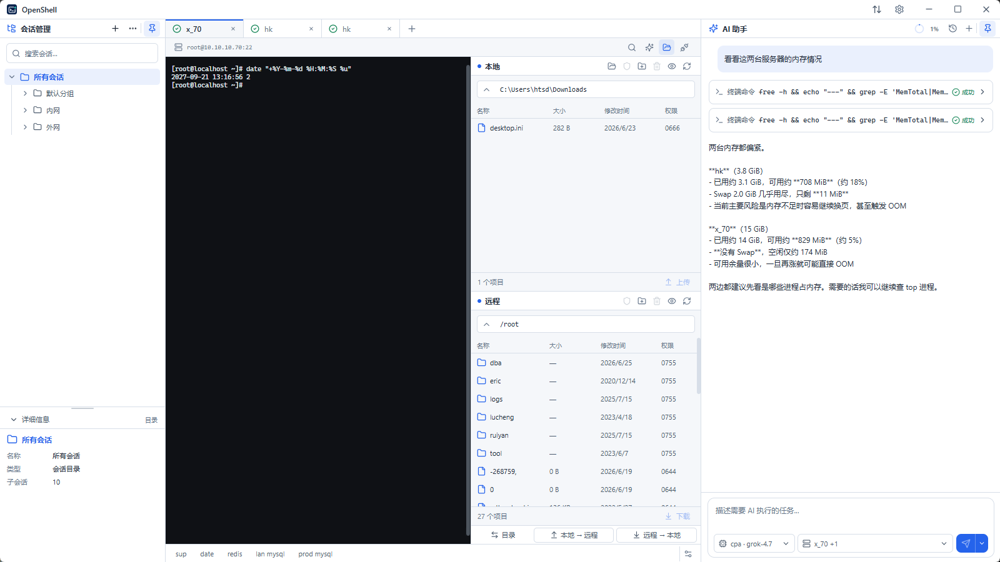
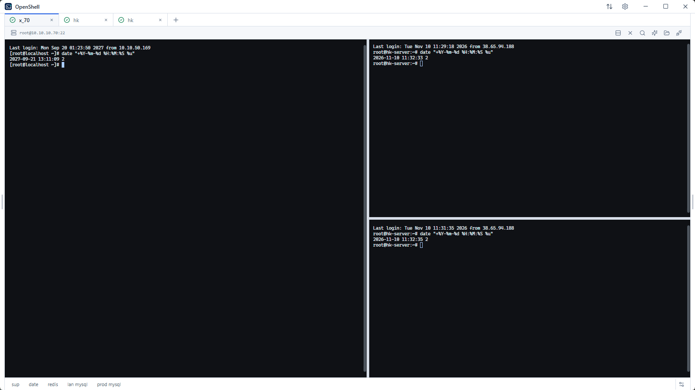
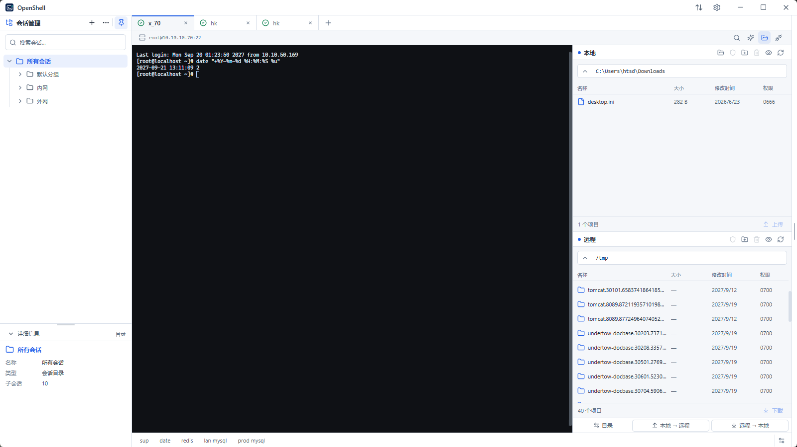
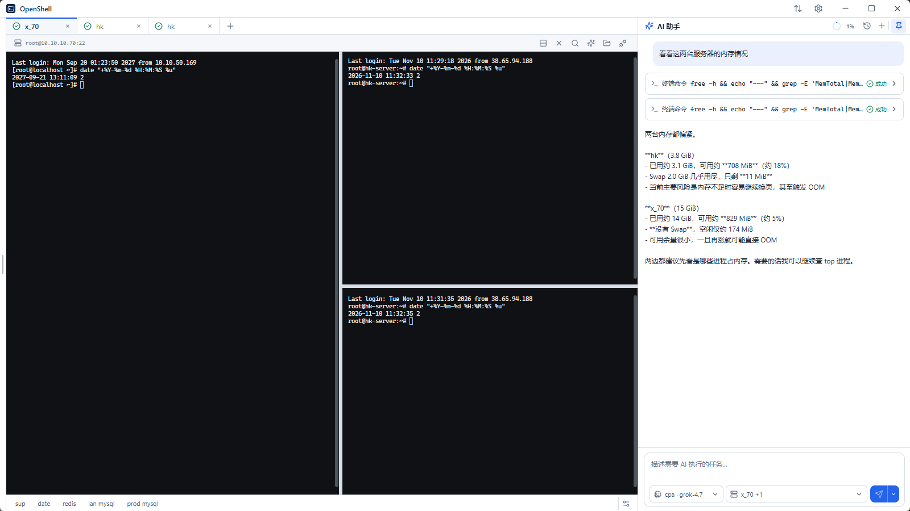
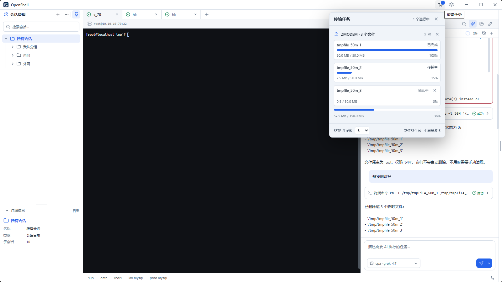

<div align="center">


# OpenShell

**A focused SSH workspace for getting server work done on Windows.**

Multi-session SSH · SFTP file manager · Native Rust ZMODEM · Optional AI assistance

[Download latest](https://github.com/hctty27/openshell/releases/latest) · [Website](https://openshell.testnb.me/) · [简体中文](README.zh-CN.md) · [Changelog](CHANGELOG.md)

[](https://github.com/hctty27/openshell/releases/latest)
[](https://github.com/hctty27/openshell/actions/workflows/ci.yml)
[](https://github.com/hctty27/openshell/releases/latest)
[](LICENSE)

</div>

OpenShell brings SSH terminals, SFTP file management, file transfers and optional AI assistance into one Windows desktop workspace. Connect to servers, organize sessions, work with remote files and handle everyday operations without constantly switching tools.

## Product preview

<p align="center">
  
</p>

<p align="center"><sub>SSH sessions, terminal, SFTP and AI assistant in one workspace.</sub></p>

| SSH sessions and split panes | SFTP file manager |
|:---:|:---:|
|  |  |
| **Global AI assistant** | **Native Rust ZMODEM** |
|  |  |

## Core capabilities

### SSH workspace
- Multi-session tabs, session tree, drag reordering and duplicate connections.
- Horizontal and vertical split panes for working across servers.
- Reconnection after unexpected disconnects, output search and local shells.
- Password and local private-key authentication with SSH host-key verification.

### SFTP file manager
- Local and remote browsing with batch uploads and downloads.
- Transfer queue, cancellation, retry and verified-prefix resume.
- Remote text editing, permission management and one-way directory-sync preview.
- Open SFTP in the remote working directory reported by the terminal.

### Native file transfer
- Native Rust ZMODEM engine on Windows for rz / sz.
- Multi-file transfers, progress reporting and task cancellation.
- trz / tsz support when trzsz is installed on the remote host.
- No Windows lrzsz installation or additional PATH configuration required.

### Optional AI assistance
- Configure compatible model APIs and model IDs.
- Global AI assistant can work with selected SSH sessions.
- Terminal AI assists within the active SSH terminal.
- Interactive workflows include MySQL/MariaDB, Redis, PostgreSQL (psql) and Python.
- AI is optional. SSH and SFTP work without a configured model.

### Session management and customization
- Import Xshell .xts / .xsh sessions.
- Session folders, quick commands, backup and restore.
- English / Simplified Chinese, light / dark application themes and independent terminal palettes.

## Download

Get the latest Windows x64 build from **[GitHub Releases](https://github.com/hctty27/openshell/releases/latest)**.

| Package | Use |
|---|---|
| OpenShell-vX.Y.Z-windows-x64-Setup.exe | Recommended. Install normally and launch from the Start menu. |
| OpenShell-vX.Y.Z-windows-x64-portable.zip | Portable use. Extract the complete archive and keep the zmodem directory beside the application. |

Requires [Microsoft Edge WebView2 Runtime](https://developer.microsoft.com/microsoft-edge/webview2/).

> Check each Release's notes for the actual code-signing status of that build. Do not assume every version is signed.

## Quick start

1. Download and launch OpenShell.
2. Create an SSH session with the host, port, username and authentication details.
3. Verify the SSH host-key fingerprint on the first connection.
4. Use tabs and split panes after connecting, or open SFTP from the terminal toolbar.
5. To enable AI features, configure a model provider in **Settings → AI**.

See the [project documentation](docs/) for detailed guides.

## Privacy and security

- Sessions, preferences and trusted host keys are stored locally.
- Passwords and private-key passphrases use Windows Credential Manager.
- Private-key files remain under your control; OpenShell stores their paths.
- Prompts and relevant context are sent to your configured model provider only when you actively use AI.
- SSH host keys are verified on first connection. A changed trusted fingerprint blocks the connection.

Policies and supply-chain information:
[Privacy policy](PRIVACY.md) · [Code signing policy](CODE_SIGNING_POLICY.md) · [Third-party review](docs/third-party-review.md) · [SBOM](docs/sbom.md)

## Project status and platform support

- Current release platform: Windows x64.
- Installer and portable packages are available.
- Licensed under the MIT License.
- macOS and Linux desktop packages are not currently provided.
- ProxyJump / jump hosts, SSH agent authentication and cloud sync are not currently supported.

## Development

**Stack:** Go · Wails v3 · React · TypeScript · xterm.js · SQLite · Rust.

The Windows development environment requires Go 1.26+, Node.js 22, npm and WebView2.

```powershell
git clone https://github.com/hctty27/openshell.git
cd openshell

go install github.com/wailsapp/wails/v3/cmd/wails3@v3.1.0

cd frontend
npm ci
cd ..

wails3 dev
```

See the [Windows release workflow](.github/workflows/windows-release.yml) and [CI workflow](.github/workflows/ci.yml) for testing, Windows builds and release automation.

## Feedback and contributions

Please open a [GitHub Issue](https://github.com/hctty27/openshell/issues) and include:
- OpenShell and Windows versions.
- Reproduction steps and expected / actual behavior.
- Redacted diagnostic logs where relevant.

Keep both English and Chinese READMEs aligned when documenting behavior changes.

## License

OpenShell is licensed under the [MIT License](LICENSE). Third-party dependencies and bundled components retain their respective licenses. See the [third-party review](docs/third-party-review.md) and [SBOM](docs/sbom.md).
