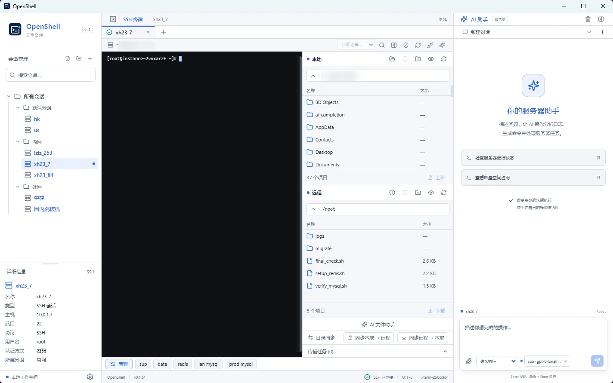

<div align="center">
  
  <h1>OpenShell</h1>
  <p><strong>Free and open-source SSH/SFTP client for Windows — terminal tabs, splits, file transfers and quick commands.</strong></p>
  <p>
    <a href="https://github.com/hctty27/openshell/releases/latest"></a>
    <a href="https://github.com/hctty27/openshell/actions/workflows/ci.yml"></a>
    <a href="https://github.com/hctty27/openshell/releases/latest"></a>
    <a href="LICENSE"></a>
  </p>
  <p><strong>English</strong> · <a href="README.zh-CN.md">简体中文</a></p>
  <p>
    <a href="https://openshell.testnb.me/">Official website</a> ·
    <a href="https://github.com/hctty27/openshell/releases/latest">Download</a> ·
    <a href="#quick-start">Quick start</a> ·
    <a href="CHANGELOG.md">Changelog</a> ·
    <a href="https://github.com/hctty27/openshell/issues">Report an issue</a>
  </p>
</div>

OpenShell is a free, open-source Windows SSH/SFTP client for developers and server administrators. Manage servers with tabs and split terminals, transfer files with SFTP or rz/sz, import Xshell sessions, and run saved quick commands.

**Status:** v1.0 stable release, with ongoing maintenance. Windows x64 installers and portable packages are available. See the [release notes](https://github.com/hctty27/openshell/releases) for the changes and signing status of each build.

**Policies:** [Code signing policy](CODE_SIGNING_POLICY.md) · [Privacy policy](PRIVACY.md) · [Third-party license review](docs/third-party-review.md) · [SBOM and binary inventory](docs/sbom.md) · [SignPath application checklist](docs/signpath-application-checklist.md).

## Screenshots

**SSH terminal and SFTP file manager**



## Why OpenShell

- **Work like a terminal power user.** Organize SSH sessions, rearrange tabs, split terminals, and reconnect without rebuilding your workspace.
- **Move files in the same window.** Use SFTP, `rz` / `sz`, or `trz` / `tsz` with an embedded picker and a non-modal global transfer center.
- **Focused by design.** Use SSH, SFTP and terminal tools without an external AI provider or API key.

## Highlights

| Area | What you can do |
| --- | --- |
| SSH workspace | Open, duplicate, drag-reorder, and split terminal tabs; search output and use interactive programs such as vim and top. |
| Session management | Organize connections in nested folders, search and edit sessions, authenticate with a password or local private key, import Xshell sessions, and export session backups. |
| Connection controls | Configure keepalive and reconnection, disconnect manually, return to a local Windows shell, and confirm before closing live connections. |
| SFTP | Browse local and remote files, upload and download files or directories, resume transfers, edit remote text, preview one-way directory sync, and manage permissions. |
| Terminal file transfers | Use `rz` / `sz` or `trz` / `tsz` with an embedded file picker and a cross-session transfer center—without opening Explorer or an extra CMD window. |
| Quick commands | Save reusable commands with search, ordering, and global, folder, or session scope. Line breaks control when commands execute. |
| Appearance and language | Switch between English and Simplified Chinese, light and dark application themes, and independent classic, dark, or light terminal palettes. |

## Download

Get the latest build from **[GitHub Releases](https://github.com/hctty27/openshell/releases/latest)**.

| Package | Use |
| --- | --- |
| `OpenShell-vX.Y.Z-windows-x64-Setup.exe` | Install OpenShell on Windows. |
| `OpenShell-vX.Y.Z-windows-x64-portable.zip` | Extract the entire archive and run `OpenShell-vX.Y.Z.exe`. Keep the bundled `zmodem` directory beside it. |

The application requires [Microsoft Edge WebView2 Runtime](https://developer.microsoft.com/microsoft-edge/webview2/). The local terminal fallback uses Windows ConPTY. PowerShell 7 and WSL must be installed separately if you select them.

The portable package skips installation; settings and credentials still use your Windows user profile.

## Quick start

1. **Add a session.** Enter the host, port, username, and password or private-key details. Single-click a session to inspect it; double-click to connect.
2. **Verify the server.** Check the SSH host-key fingerprint before trusting the first connection. A changed trusted fingerprint blocks the connection.
3. **Choose your workspace.** Use tabs and split panes for terminals, or open SFTP from the terminal toolbar to manage files.
4. **Set your preferences.** In Settings, use **General** for language and application appearance, **Terminal** for terminal options, and **Connection** for keepalive, reconnection, and disconnect behavior.

The interface defaults to English; switch to Simplified Chinese in Settings → General. You can edit a connected session: its name and folder update immediately, while host, port, user, and authentication changes apply on the next connection.

### Terminal workflow

- Double-click a connected tab to open another independent connection with the same session name. Drag tabs to reorder them, or use Alt+Shift+Left/Right Arrow. The `+` button opens the session picker.
- Connect two sessions, select the split partner, and switch between horizontal and vertical layouts. Drag the divider to resize the panes.
- Enable selection-to-copy and right-click paste in Settings if desired. Multiline paste can require confirmation.
- Choose a global terminal palette or override it per session; changes apply without reconnecting. The quick-command bar supports a single scrolling row or multiple rows.
- Configure disconnect behavior to return to a local shell, keep the disconnected tab, or close it. Local choices include Windows PowerShell, PowerShell 7, CMD, and WSL. Automatic reconnection applies to unexpected disconnects, not a manual disconnect. Closing an active SSH tab or exiting while connections are live requires confirmation.
- Use **Manage** in the quick-command bar to add commands. Each line break sends Enter; without a final line break, the last line is inserted without executing. Run these only when the terminal is ready to receive shell input.

## Files and transfers

### SFTP

Open the file manager from a connected SSH tab. It reuses the authenticated connection and offers local/remote browsing, drag-and-drop transfers, a task queue, cancellation, retry, and verified-prefix resume.

- **Remote editing:** UTF-8 text files up to 1 MiB, with a remote-version check before saving.
- **Directory sync:** preview local-to-remote or remote-to-local changes based on size and modification time. Newer destination files are skipped; the current sync workflow does not delete files.
- **Permissions:** review and confirm changes for up to 200 selected items.

### Open SFTP in the terminal's directory

OpenShell recognizes directory reports from **OSC 7**, **OSC 1337**, and **OSC 0/2 titles** such as `user@host:/path`. If the remote shell already reports its directory, no extra setup is needed. Otherwise SFTP falls back to the known initial directory, or its default directory if the reported path is unavailable. It does not inject hidden `pwd` commands into an interactive program.

<details>
<summary>Enable directory reporting for remote Bash</summary>

Add the following once to the remote `~/.bashrc`. It preserves an existing `PROMPT_COMMAND` and escapes URI-sensitive characters in the path.

```bash
__openshell_report_cwd() {
  local path="${PWD//%/%25}"
  path="${path//#/%23}"
  path="${path//\?/%3F}"
  printf '\033]7;file://%s%s\007' "${HOSTNAME:-localhost}" "$path"
}
if declare -p PROMPT_COMMAND 2>/dev/null | grep -q '^declare -a'; then
  PROMPT_COMMAND+=(__openshell_report_cwd)
else
  PROMPT_COMMAND="${PROMPT_COMMAND:+${PROMPT_COMMAND};}__openshell_report_cwd"
fi
```

Reconnect to apply the change. Each new prompt reports the current directory; opening SFTP after `cd /some/path` uses that reported path.

</details>

### ZMODEM: `rz` / `sz`

Run `rz` on the remote host to choose local files to upload, or `sz /path/to/file` to choose a local destination for downloads. The remote host must have `lrzsz` installed. Official Windows installer and portable packages use **native Rust ZMODEM**: `zmodem/native/zmodem-sidecar.exe` is the sole local Windows ZMODEM engine. `zmodem/rz.exe` and `sz.exe` are first-party GUI-subsystem launchers that forward the protocol stream to Rust. No `lrzsz-win32` binaries or `msys-2.0.dll` are bundled; remote Linux hosts still require `lrzsz`. No Windows PATH setup or additional console window is needed.

OpenShell's compact embedded picker handles local file and destination selection without opening Windows Explorer. Progress appears in a non-modal transfer center in the workspace header; switch tabs freely while transfers continue, or cancel through the transfer center or Ctrl+C. The bundled launcher avoids a separate CMD window. Downloads use the `rz -E` rename strategy for existing filenames. Protocol payloads are filtered before terminal history and AI context. ZMODEM can be unreliable inside tmux/screen; use SFTP for directories and resumable transfers.

### Native trzsz: `trz` / `tsz`

Install `trzsz` on the remote host, then use `trz` to upload and `tsz file` to download; `trz -d` supports selecting directories. Both protocols use OpenShell's embedded picker and global transfer center. Native trzsz displays per-file percentages, while traditional `rz` / `sz` use an indeterminate bar when a trustworthy total is unavailable. SSH tabs retain independent transfer state, so switching from A to B does not stop A's transfer.

## Import and backup

| Source | What is included | What to configure again |
| --- | --- | --- |
| Xshell `.xts` / `.xsh` | SSH connection settings and folder structure; UTF-16 and UTF-8 files are supported. Preview and select sessions, then skip or rename duplicate names. | Passwords and private-key authentication. Xshell-encrypted credentials, Telnet, proxy, and jump-host settings are not imported. |
| OpenShell JSON backup | Saved SSH sessions and nested folders. Export and restore through Settings → General → Session backup. | Credentials and private-key files. Appearance preferences are not included in session backups. |

To migrate from Xshell, export sessions, choose **Import Xshell** in OpenShell's session panel, review the import, and re-enter authentication details before connecting.

## Local data and privacy

| Data | Storage |
| --- | --- |
| Sessions, folders, preferences, trusted host keys | `%APPDATA%\OpenShell\state.db` |
| Passwords and private-key passphrases | Windows Credential Manager, under OpenShell entries. |
| Private keys | Your selected files; OpenShell stores their paths. |

OpenShell connects to configured SSH/SFTP servers when requested. Legacy AI configurations and conversations from earlier versions may remain in the local database after upgrading; this release does not delete them automatically.

## Development

**Stack:** Go · Wails v3.1.0 · React · TypeScript · xterm.js · SQLite.

Use a Windows development environment with Go 1.26+, a current Node.js 22 release compatible with the locked Vite version, npm, and WebView2. Dependency versions are recorded in [go.mod](go.mod) and [frontend/package-lock.json](frontend/package-lock.json).

```sh
git clone https://github.com/hctty27/openshell.git
cd openshell
go install github.com/wailsapp/wails/v3/cmd/wails3@v3.1.0
cd frontend
npm ci
cd ..
wails3 dev
```

Build the Windows x64 executable:

```sh
wails3 generate bindings -names -ts
wails3 generate syso -manifest build/windows/wails.exe.manifest -icon build/windows/icon.ico -info build/windows/info.json -arch amd64 -out rsrc_windows_amd64.syso
go build -tags production -trimpath -ldflags="-H windowsgui -s -w" -o build/bin/OpenShell.exe .
```

Output: `build/bin/OpenShell.exe`. Ensure `build/windows/icon.ico` has been generated before building. This build does not package the ZMODEM helpers. For the bundled utilities, run [scripts/prepare_native_zmodem_windows.ps1](scripts/prepare_native_zmodem_windows.ps1) in PowerShell after building. The [Windows release workflow](.github/workflows/windows-release.yml) contains the full icon-generation, installer, and portable-package steps.

<details>
<summary>Validation and release workflow</summary>

Run from the repository root:

```sh
go test -race ./...
go vet ./...
cd frontend
npm test -- --run
npm run build
npx playwright install chromium
npx playwright test
```

Backend tests use controlled SSH servers and mock APIs. Browser tests use a mock Wails bridge and do not replace native Windows acceptance testing.

- [CI](.github/workflows/ci.yml) runs Go race tests, `go vet`, frontend tests, a production frontend build, and selected Chromium regressions on pull requests and `main` pushes.
- [Windows terminal smoke](.github/workflows/windows-terminal-smoke.yml) covers relevant terminal, SSH, SFTP, and ConPTY pull requests.
- [Windows release](.github/workflows/windows-release.yml) publishes only after the release marker changes on `main` and CI passes. It retains the three newest Releases plus v1.0.0 and later major-version milestones, keeps older Git tags, and retains final build artifacts for seven days. Manual runs create artifacts without publishing a Release.

**Recommended:** Open [Publish OpenShell (one click)](.github/workflows/publish.yml) in GitHub Actions, select `main`, choose `patch` (default), `minor`, or `major`, and click **Run workflow**. It synchronizes the version marker, npm metadata, Windows version info and changelog; commits the release metadata; runs Go/frontend verification on that exact commit; reuses the tested frontend bundle for the Windows build; then publishes the installer and portable ZIP. If packaging fails after version preparation, rerun the workflow to resume the unpublished version without incrementing it twice. Use only one release workflow at a time.

**Legacy/manual:** You may still update `.github/release-version.txt`, `frontend/package.json`, `frontend/package-lock.json`, and `CHANGELOG.md` together, then merge to `main`; the existing release-marker CI path remains supported.

</details>

## Project notes

- Windows x64 is the currently delivered desktop platform. macOS and Linux desktop packages are not provided.
- ProxyJump/jump hosts, SSH agent authentication, cloud sync, and quick-command parameter placeholders are not currently supported.
- Native Windows input methods, clipboard behavior, credential storage, transfer edge cases, and performance require real-device validation. Tool-call compatibility depends on your API provider and model.
- Terminal-context attachments are limited to 200 lines / 32 KiB. A preview may omit a truncation notice if older terminal history was already trimmed.

For implementation details and verification scope, see [Windows acceptance](docs/windows-acceptance.md), [stability acceptance](docs/stability-acceptance.md), and [internationalization](docs/internationalization.md). These supporting documents currently include Chinese content.

Bug reports and focused pull requests are welcome. Include the OpenShell version, Windows version, reproduction steps, and redacted logs in an [issue](https://github.com/hctty27/openshell/issues). Keep the English and Chinese READMEs aligned when changing documented behavior.

## License and code signing

OpenShell is licensed under the **[MIT License](LICENSE)**. Bundled third-party components retain their own licenses; The Windows ZMODEM distribution includes only first-party launchers and the native Rust sidecar, not legacy lrzsz/MSYS2 binaries. Go, Rust and npm dependencies retain their respective third-party licenses; see the [SBOM](docs/sbom.md).

Free code signing provided by [SignPath.io](https://about.signpath.io/), certificate by [SignPath Foundation](https://signpath.org/). This is the intended provider attribution **if the application is approved and signing is enabled**. The published v1.0.0 Windows downloads are unsigned; no acceptance or signature is being claimed.

Signing is conditional on the required SignPath configuration and secrets being present. Otherwise, builds are unsigned. Check each Release's notes for its actual signing status. The application executable and installer are built through GitHub Actions; the portable ZIP contains the application executable. Only artifacts built from this repository's source code are submitted for signing.

**Committer, reviewer, and signing approver:** [hctty27](https://github.com/hctty27).
