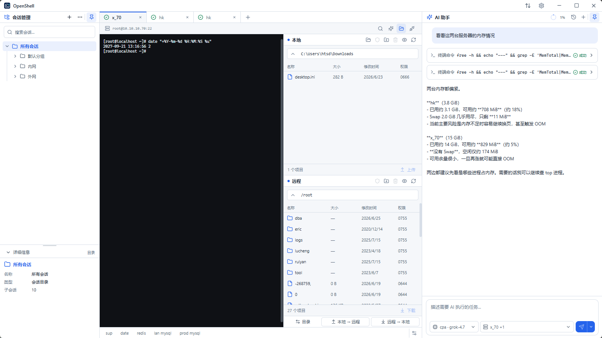
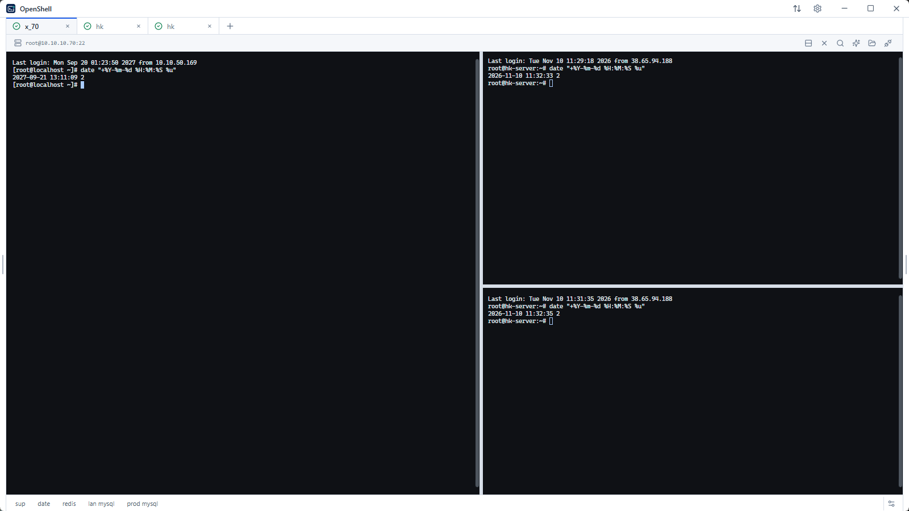
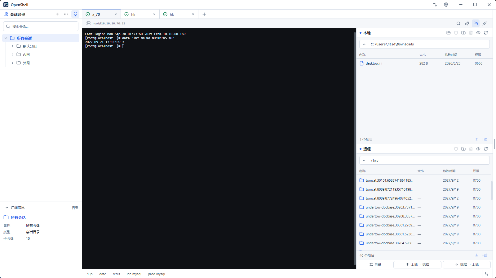
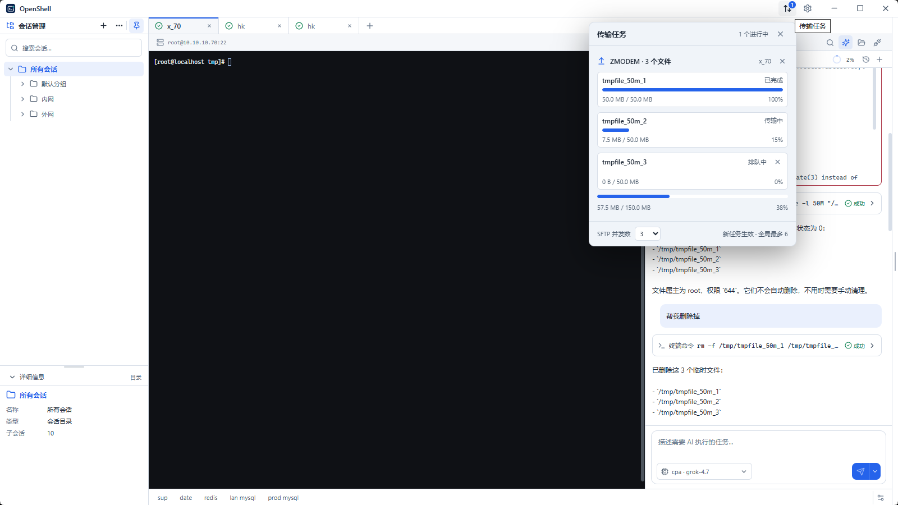
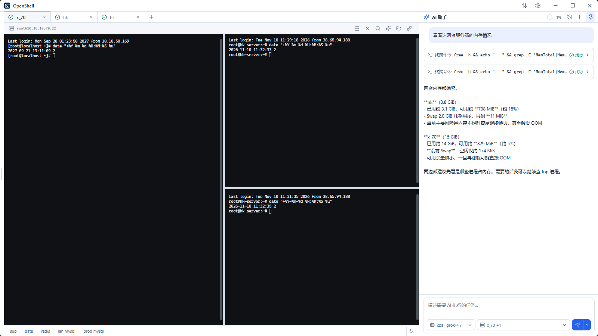

  

  # OpenShell

  **专注于 Windows 的 SSH 工作空间。**

  集中管理服务器、操作多会话终端、传输文件，并把 AI 工具融入日常工作流。

  [下载 Windows 版](https://github.com/hctty27/openshell/releases/latest) ·
  [官方网站](https://openshell.testnb.me/) ·
  [使用文档](docs/user-guide.zh-CN.md) ·
  [English](README.md)

  
  
  
  

  

OpenShell 是面向开发者与服务器管理员的免费开源 Windows 桌面应用。它将 SSH 多会话、终端分屏、SFTP、Rust 原生 ZMODEM、Xshell 会话导入和可选 AI 助手整合到同一个工作空间。

## 一个工作空间，四项核心能力

| SSH 工作空间 | SFTP 文件管理 |
| --- | --- |
|  |  |
| 使用标签、分屏管理多个会话，搜索终端输出，并按需重新连接。 | 浏览本地与远程文件，批量传输、编辑远程文本并管理传输任务。 |

| Rust 原生 ZMODEM | AI 助手 |
| --- | --- |
|  |  |
| 通过 Windows 原生 Rust 引擎处理 `rz` / `sz`。 | 配置兼容的模型 API，在全局助手或当前终端中使用 AI。 |

## 功能亮点

- **SSH 会话：** 标签、多级文件夹、复制连接、拖拽排序、水平与垂直分屏、输出搜索和断线重连。
- **SFTP：** 本地与远程文件浏览、批量上传下载、远程文本编辑、传输队列、重试和单向目录同步预览。
- **原生传输：** Windows 使用 Rust 原生 ZMODEM 处理 `rz` / `sz`；远端安装 `trzsz` 后支持 `trz` / `tsz`。
- **按需使用 AI：** 配置兼容的模型 API，即可使用全局 AI 助手或终端 AI。不配置 AI 也能正常使用 SSH 和 SFTP。
- **Xshell 迁移：** 导入受支持的 Xshell SSH 会话和文件夹结构。
- **本地优先的凭据管理：** 会话数据保存在本地应用目录，密码和私钥口令使用 Windows 凭据管理器。

## 下载安装

前往 **[GitHub Releases](https://github.com/hctty27/openshell/releases/latest)** 下载最新 Windows x64 版本。

| 安装包 | 适用场景 |
| --- | --- |
| Windows 安装版（`*-Setup.exe`） | 推荐日常安装使用。 |
| 便携版 ZIP（`*-portable.zip`） | 完整解压后运行应用，务必保留旁边的 `zmodem` 目录。 |

OpenShell 需要 [Microsoft Edge WebView2 Runtime](https://developer.microsoft.com/microsoft-edge/webview2/)。请查看每个 Release 的说明确认实际代码签名状态，不要默认所有版本都已签名。

## 快速开始

1. 下载并安装 OpenShell，或解压便携版。
2. 添加 SSH 会话，填写主机、端口、用户名以及密码或私钥认证信息。
3. 首次连接时核对 SSH 主机指纹。
4. 连接后即可使用终端、分屏工作区，或从会话中打开 SFTP。

详细配置、AI 使用、SFTP、ZMODEM、Xshell 导入、隐私、故障排查和开发说明，请查看 **[使用指南](docs/user-guide.zh-CN.md)**。

## 项目状态

OpenShell 已进入 v1.0 正式版阶段，并持续维护。目前桌面发行版面向 Windows x64，暂未提供 macOS / Linux 桌面安装包。

- [更新日志](CHANGELOG.md)
- [隐私政策](PRIVACY.md)
- [代码签名政策](CODE_SIGNING_POLICY.md)
- [第三方组件授权审查](docs/third-party-review.md)
- [SBOM 与二进制清单](docs/sbom.md)
- [反馈问题](https://github.com/hctty27/openshell/issues)

## 参与贡献

欢迎提交问题和范围明确的 PR。反馈问题时，请附上 OpenShell 版本、Windows 版本、复现步骤及脱敏日志。修改用户可见行为时，请同步维护中英文项目文档。

## 许可证

OpenShell 使用 [MIT 许可证](LICENSE)。随包分发的第三方依赖遵循各自许可证，详见 [SBOM](docs/sbom.md) 和[第三方组件审查](docs/third-party-review.md)。
